<picture>
  <source media="(prefers-reduced-motion: reduce) and (prefers-color-scheme: dark)" srcset="assets/duel-still-dark.svg">
  <source media="(prefers-reduced-motion: reduce)" srcset="assets/duel-still-light.svg">
  <source media="(prefers-color-scheme: dark)" srcset="assets/duel-dark.svg">
  
</picture>
